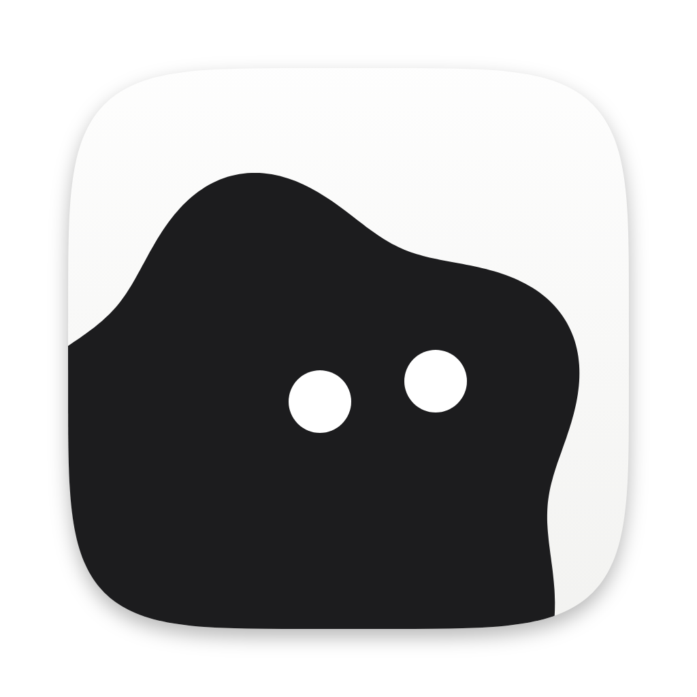
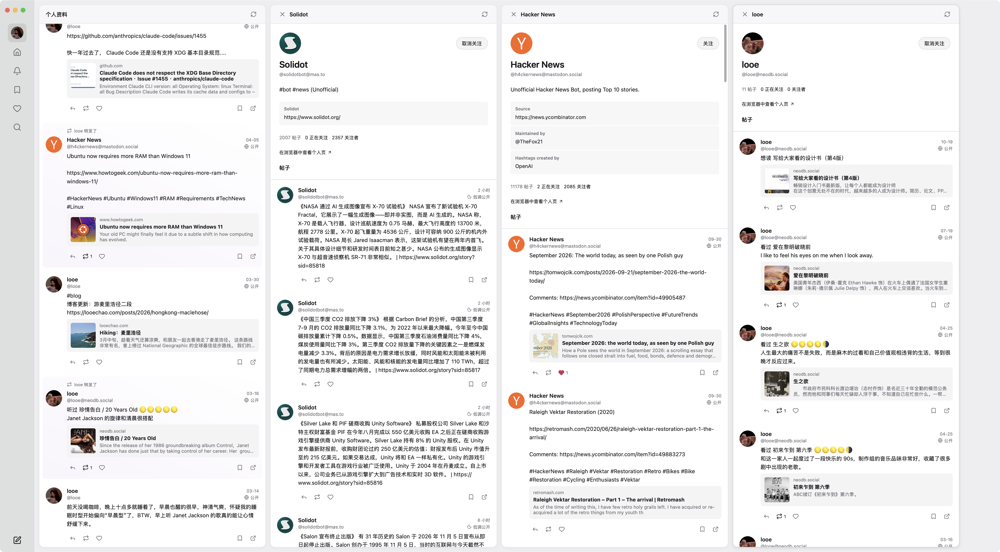

# Ceramic

Another desktop app for Mastodon.

Connect your Mastodon account and explore the Fediverse in a lightweight native app.

[Website](https://ceramic.looechao.com) · [Download the latest release](https://github.com/looechao/ceramic/releases/latest) · [中文说明](README.zh-CN.md) · [MIT License](LICENSE)



## Features

- Open posts and profiles in columns to the right, keeping your place as you read.
- Browse timelines, search, follow conversations, and like, boost, bookmark, or reply.
- Write posts with images, descriptions, polls, and content warnings. Drafts stay on your computer.
- View images and notifications, choose light or dark appearance, and navigate with the keyboard.

Ceramic supports one Mastodon account using the Mastodon API. Other Fediverse server implementations may not be compatible; the Misskey API is not supported. Offline post caching and voting in the app are not yet supported.

## Install

Download a build from [Releases](https://github.com/looechao/ceramic/releases/latest). Ceramic is developed and used primarily on macOS, and builds are also available for Windows and Linux; those two platforms have not yet been tested on physical machines. Linux requires GTK 3.

Builds are not signed with an Apple Developer ID or notarized. On first launch, macOS may require you to allow Ceramic in **System Settings → Privacy & Security**. Windows may show a SmartScreen warning.

Enter your instance domain, such as `mastodon.social`, and authorize Ceramic in your browser to start reading.

## Shortcuts

Command means <kbd>⌘</kbd> on macOS and <kbd>Ctrl</kbd> on Windows and Linux. Reading shortcuts act on the focused column and are disabled while typing in search.

| Shortcut | Action |
| --- | --- |
| <kbd>Shift</kbd> + <kbd>H</kbd> / <kbd>Shift</kbd> + <kbd>L</kbd> | Focus the previous / next column; <kbd>J</kbd> and <kbd>K</kbd> also work |
| <kbd>j</kbd> / <kbd>k</kbd> | Scroll down / up |
| <kbd>d</kbd> / <kbd>u</kbd> | Scroll down / up half a page |
| <kbd>g</kbd> <kbd>g</kbd> | Go to the top (press twice within one second) |
| <kbd>Shift</kbd> + <kbd>G</kbd> | Go to the bottom of loaded content |
| Command + <kbd>W</kbd> | Close the focused detail column, or the window when the main column is focused |
| Command + <kbd>1</kbd> / <kbd>2</kbd> / <kbd>3</kbd> | Profile / Home / Notifications |
| Command + <kbd>4</kbd> / <kbd>5</kbd> / <kbd>6</kbd> | Bookmarks / Favorites / Explore |
| Command + <kbd>N</kbd> / <kbd>R</kbd> | Compose / refresh |
| <kbd>←</kbd> / <kbd>→</kbd> | Move between images in the image viewer |
| <kbd>Esc</kbd> | Clear search, leave search, cancel a key sequence, or close an image |

## Development

Requires Go 1.27.3 or later. No Node, npm, or Bun is needed.

```sh
./scripts/dev.sh
./scripts/build.sh
go vet ./...
go test -race ./...
```

Ceramic connects directly to your instance and stores its access token locally. The current macOS prototype does not yet use Keychain encryption. See the [Chinese documentation](README.zh-CN.md) for builds, data storage, and architecture.

## License

Ceramic is released under the [MIT License](LICENSE). Third-party dependencies and assets retain their respective licenses.
